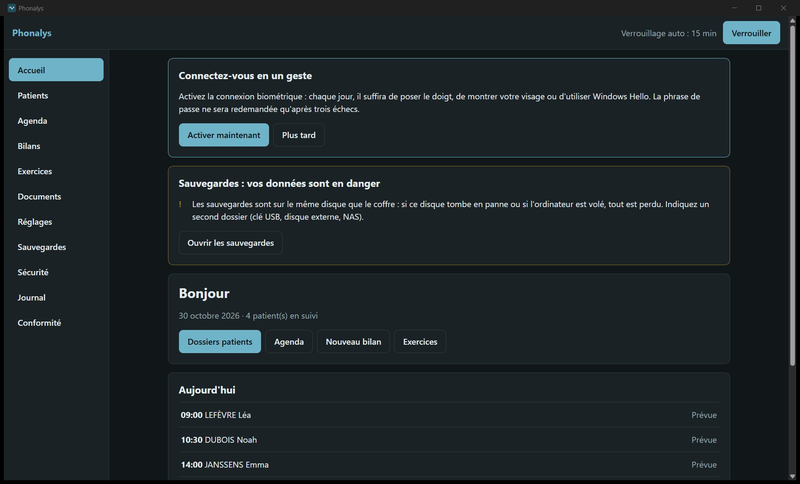
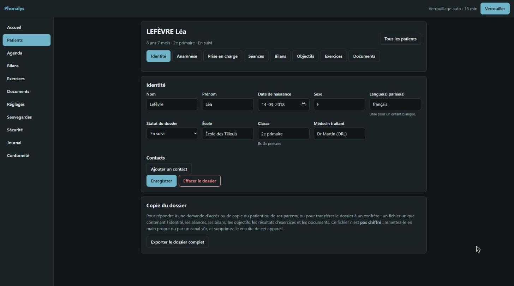
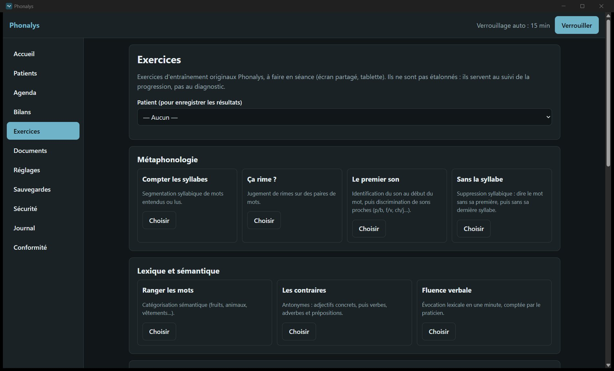
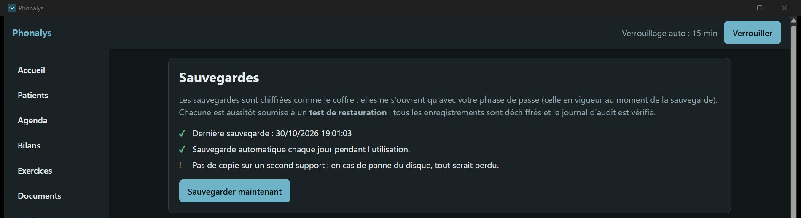
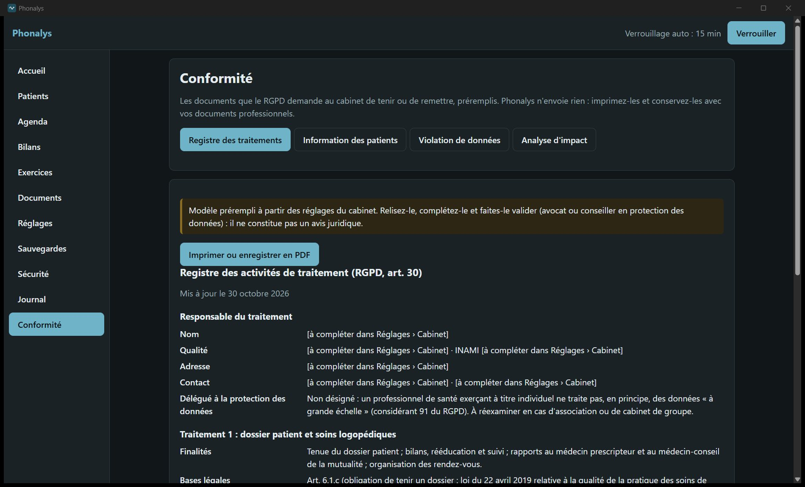
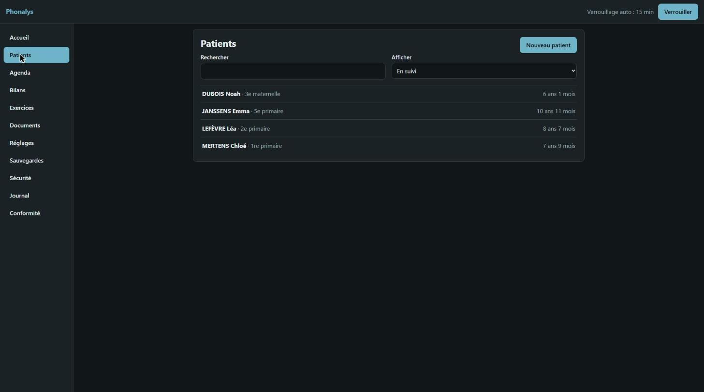
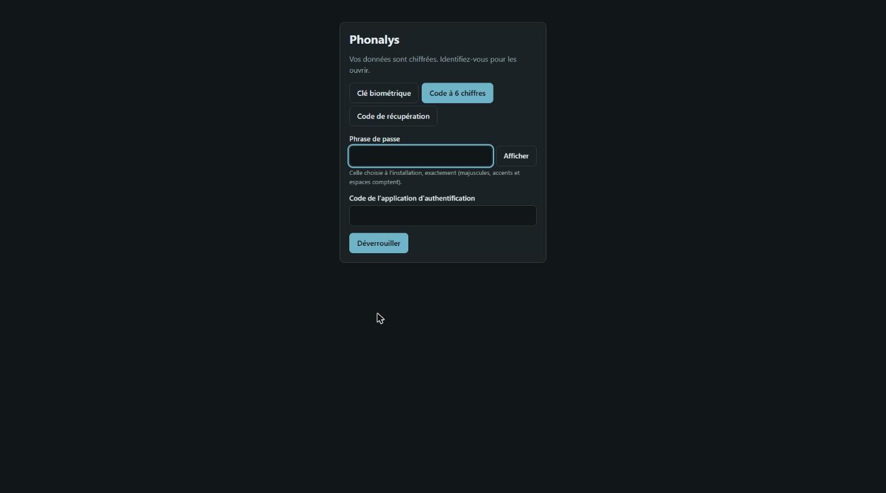
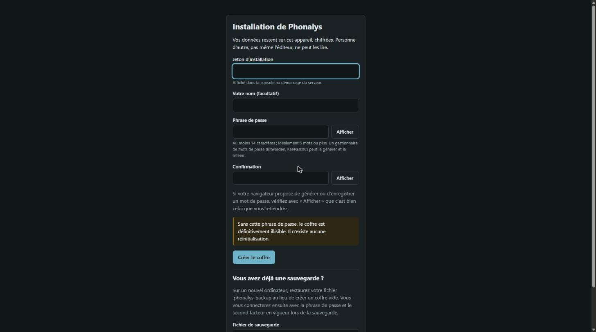

# Phonalys

**Plateforme d'évaluation et de rédaction de bilans logopédiques, auto-hébergée, avec IA personnelle locale.**

Phonalys s'adresse aux logopèdes indépendants. Le praticien fait passer ses épreuves, l'outil cote les résultats selon les normes, puis l'IA, qui tourne sur le matériel du praticien, rédige les bilans et documents à partir de ses propres modèles. Les données patients ne quittent jamais l'infrastructure du praticien.

> Logiciel propriétaire : voir [LICENSE](LICENSE). Toute reproduction est interdite.

## Aperçu

Captures de la version 0.1.3. Tous les patients sont fictifs.



| | |
|---|---|
|  |  |
| **Agenda** : séances de la semaine, absences signalées. | **Dossier patient** : identité, anamnèse, prise en charge, séances, bilans, objectifs, exercices et documents. |
|  |  |
| **Évolution entre les bilans** : percentiles, notes standard et scores z ramenés sur une même échelle. | **Exercices** : métaphonologie, lexique, suivi de la progression du patient. |
|  |  |
| **Sécurité** : clés biométriques (Windows Hello, Face ID, YubiKey), mode lié au matériel. | **Journal d'audit** chaîné par HMAC : toute altération est détectée. |
|  |  |
| **Sauvegardes** chiffrées, testées par une restauration automatique. | **Conformité** : registre des traitements, notice patients, violations, analyse d'impact. |
|  |  |
| **Patients** : recherche et suivi par statut. | **Connexion** : phrase de passe et second facteur, ou clé biométrique. |



## Principes

1. **Les données restent chez le praticien.** Aucun serveur central ni compte hébergé par l'éditeur, et aucune télémétrie.
2. **IA locale uniquement.** Ollama, llama.cpp, LM Studio, vLLM… sur la machine ou le réseau privé du praticien. Les IA grand public (ChatGPT, Claude, Gemini, Mistral cloud…) sont **bloquées par construction**, voir [`phonalys-ai`](crates/phonalys-ai).
3. **Chiffrement au repos.** Le chiffrement utilise XChaCha20-Poly1305, les clés sont dérivées par Argon2id et organisées en enveloppes (une clé par dossier patient).
4. **Double authentification obligatoire, biométrie possible.** Windows Hello, Touch ID, Face ID, l'empreinte Android ou une clé FIDO2 (YubiKey Bio) sont acceptés, et peuvent être rendus obligatoires. Le TOTP et les codes de récupération servent de secours. Aucune donnée biométrique ne quitte l'appareil. En **mode lié au matériel** (extension PRF), la clé du coffre dépend aussi de l'appareil : la phrase de passe volée avec le fichier ne suffit plus à le déchiffrer.
5. **Le praticien décide.** L'IA propose, le logopède valide. Aucun document ne sort sans relecture humaine.

## Composants

| Élément | Rôle | État |
|---|---|---|
| `crates/phonalys-crypto` | Dérivation de clés, chiffrement authentifié, enveloppes, hachage des mots de passe | ✅ testé |
| `crates/phonalys-psychometrics` | Âge, normes, z, percentiles, notes standard/échelle/T, IC 95 %, RCI | ✅ testé |
| `crates/phonalys-core` | Batteries déclaratives (JSON), cotation, journal d'audit chaîné par HMAC | ✅ testé |
| `crates/phonalys-ai` | Politique réseau IA (local uniquement), client Ollama / API locale avec épinglage TLS, pseudonymisation | ✅ testé |
| `crates/phonalys-vault` | Coffre SQLite chiffré par enregistrement, délai après échecs, audit persistant | ✅ testé |
| `crates/phonalys-auth` | Politique de phrase de passe, TOTP (RFC 6238), codes de récupération, sessions | ✅ testé |
| `crates/phonalys-webauthn` | Clés biométriques et de sécurité (WebAuthn/FIDO2), vérifiées sans OpenSSL | ✅ testé |
| `crates/phonalys-server` | Serveur TLS 1.3 et autorité locale du cabinet : installation, connexion 2FA et biométrique, verrouillage auto, dossier clinique, coffre documentaire, sauvegardes, assistant de rédaction, appairage | ✅ testé |
| `web` | Interface React + TypeScript servie par le serveur, installable en PWA (iPhone, Android) | ✅ testé |
| `apps/desktop` | Application Tauri 2 (Windows, Linux) avec serveur embarqué sur la boucle locale | ✅ compile, lancement vérifié |

## Développement

Prérequis : [Rust stable](https://rustup.rs) et Node.js 24. Sous Windows, il faut aussi les Build Tools MSVC.

```sh
cargo test --workspace          # tous les tests
cargo clippy --workspace --all-targets -- -D warnings
cd web && npm ci && npm test && npm run build && cd ..   # interface (web/dist)
cargo run -p phonalys-server    # écoute sur https://127.0.0.1:8443 (TLS 1.3)
```

Application de bureau (espace de travail séparé, car Tauri apporte ses dépendances graphiques) :

```sh
cd web && npm run build && cd ..
cargo run --manifest-path apps/desktop/Cargo.toml
```

Sous Linux, installez d'abord `libwebkit2gtk-4.1-dev`, `librsvg2-dev` et `libxdo-dev`. Les installateurs (MSI, NSIS, .deb, .rpm, AppImage) sont construits par le workflow « Publication » : voir [docs/PUBLICATION.md](docs/PUBLICATION.md).

Au premier démarrage du serveur autonome, la console affiche un **jeton d'installation à usage unique** et l'**empreinte de l'autorité locale du cabinet**.

### Connecter les téléphones et tablettes

1. Donnez au serveur un nom du réseau local (par exemple `phonalys.lan`, déclaré dans le DNS de la box ou du routeur) et démarrez-le avec `PHONALYS_BIND=0.0.0.0:8443` et `PHONALYS_PUBLIC_ORIGIN=https://phonalys.lan:8443`.
2. Sur l'ordinateur, ouvrez « Sécurité › Téléphones et tablettes » : un QR code s'affiche.
3. Scannez-le avec le téléphone, comparez l'empreinte affichée des deux côtés, puis installez le profil (iPhone, iPad) ou le certificat (Android).
4. Ajoutez Phonalys à l'écran d'accueil et activez la connexion biométrique.

L'autorité du cabinet est limitée par une contrainte de noms aux adresses du réseau local. Même si sa clé était volée, elle ne permettrait d'usurper aucun site public.

| Variable | Défaut | Rôle |
|---|---|---|
| `PHONALYS_DATA_DIR` | `%LOCALAPPDATA%\Phonalys` / `~/.local/share/Phonalys` | Coffre et certificat |
| `PHONALYS_BIND` | `127.0.0.1:8443` | Adresse d'écoute (`0.0.0.0:8443` pour le réseau local) |
| `PHONALYS_PUBLIC_ORIGIN` | `https://localhost:8443` | Adresse exacte utilisée par les appareils, qui sert d'identité WebAuthn (nom de domaine obligatoire). **Seule cette adresse est acceptée** (protection contre le DNS rebinding) |
| `PHONALYS_TLS_NAMES` | — | Noms et adresses IP supplémentaires du certificat, par exemple `phonalys.lan,192.168.1.20` (le nom de `PHONALYS_PUBLIC_ORIGIN` y figure toujours) |
| `PHONALYS_BACKUP_DIR` | `sauvegardes` dans le dossier de données | Dossier des sauvegardes chiffrées |
| `PHONALYS_WEB_DIR` | `web` à côté de l'exécutable, sinon `web/dist` | Dossier de l'interface compilée |
| `PHONALYS_INSECURE_HTTP` | — | `1` = HTTP en clair, **refusé hors de 127.0.0.1** (développement) |

## Documentation

- [Installer Phonalys (guide du praticien)](docs/INSTALLATION.md)
- [Architecture](docs/ARCHITECTURE.md)
- [Sécurité et modèle de menace](docs/SECURITE.md)
- [Conformité légale (RGPD, droit belge, MDR, AI Act)](docs/CONFORMITE.md)
- [Publier une version](docs/PUBLICATION.md)
- [Feuille de route](docs/ROADMAP.md)
