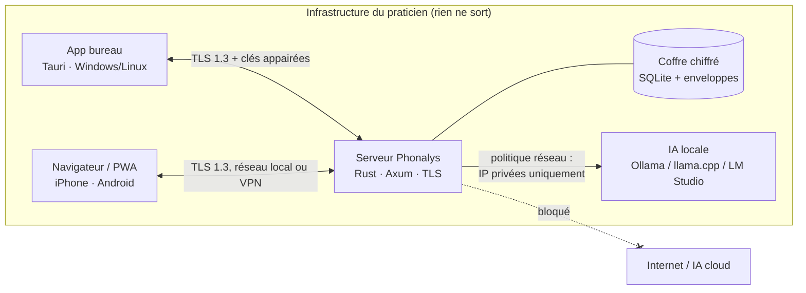

# Architecture

## Vue d'ensemble

## Modes de déploiement

| Mode | Pour qui | Fonctionnement |
|---|---|---|
| **Poste seul** | Indépendant avec un seul PC | L'application de bureau embarque le serveur en local (127.0.0.1). |
| **Serveur personnel** | Cabinet, accès multi-appareils | Serveur sur un mini-PC, un NAS ou un PC Linux. Les autres appareils l'utilisent par le navigateur ou la PWA (pas de copie locale : sans réseau, pas d'accès ; la synchronisation hors ligne n'existe pas). |
| **Accès distant** | Consultation à domicile ou en école | Uniquement via un VPN du praticien (WireGuard, Tailscale/Headscale). Ne **jamais** exposer le port directement sur Internet. |

L'interface web n'existe que si le praticien héberge son serveur. L'éditeur n'héberge rien.

## Crates

- **phonalys-crypto** : primitives cryptographiques uniquement, sans E/S. Voir [SECURITE.md](SECURITE.md#cryptographie).
- **phonalys-psychometrics** : calculs purs et déterministes, testés par propriétés (monotonie, bornes, réciprocité Φ/Φ⁻¹).
- **phonalys-core** : le modèle métier. Une **batterie** est un document JSON validé à l'import : épreuves, items, règle de cotation, table de normes, seuils. Le moteur ne contient aucun contenu de test.
- **phonalys-ai** : toute requête vers un modèle passe par `EndpointPolicy` (URL, puis adresses résolues, puis connexion figée sur ces adresses) et par `Pseudonymizer`.
- **phonalys-server** : API HTTP en TLS 1.3, sessions, WebAuthn, dossier clinique, documents, sauvegardes, assistant de rédaction, appairage, en-têtes de durcissement, limite de taille.

## Contenu des épreuves

Il provient de trois sources, toujours tracées dans les rapports (`ContentOrigin`) :

1. **Épreuves originales Phonalys**, conçues par l'équipe, avec des normes issues de nos propres études.
2. **Épreuves sous licence** du praticien (par exemple un manuel acheté), qu'il encode lui-même. Phonalys n'en distribue rien.
3. **Épreuves maison** du praticien.

## IA : flux de rédaction d'un bilan

1. Le praticien choisit un **modèle de document** (ses propres bilans servent d'exemples de style et de mise en forme).
2. Phonalys assemble le contexte : anamnèse, résultats cotés, graphiques, observations cliniques et rappel des règles légales en vigueur.
3. Les identifiants sont pseudonymisés, puis la requête part vers le modèle local validé.
4. La réponse est proposée dans le bilan (conclusion et projet thérapeutique), puis **relue et validée** par le praticien. L'export DOCX/ODT/PDF n'existe pas encore (impression du bilan seulement).
5. Chaque génération est inscrite dans le journal d'audit.
